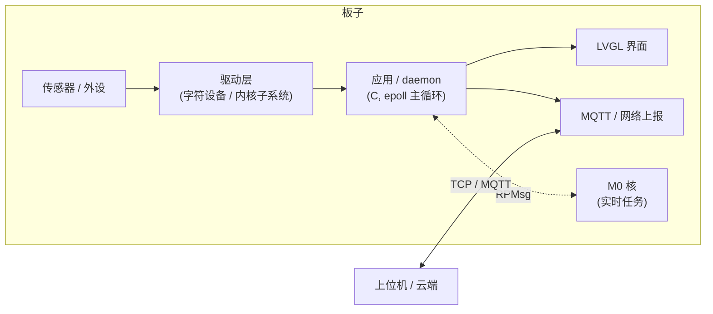

# 项目架构（第 5 周冻结）

> 状态：**未冻结**。第 5 周（12/28–01/03）必须填完并打 tag `arch-frozen`，之后只允许小改。
> 为什么要提前冻结：第 7 周只有 5 天，边设计边实现会两样都做不好。

## 一句话描述

（讲给不懂技术的人听。说不出来就说明还没想清。）

## 题目选择

- [ ] **A. 数据采集网关**：串口读传感器 → LVGL 显示曲线 → MQTT 上报 → 超阈值报警
- [ ] **B. 简易 HMI 控制面板**：LVGL 界面 → 按键 → M0 控制继电器 → 状态回显
- [ ] **C. CAN 总线监视器**：抓 CAN 报文 → 解析 → 界面列表

**选择理由**（结合已跑通的模块，不要选没验证过的）：

## 架构图

## 数据流

| 步 | 输入 | 处理 | 输出 | 在哪一层 |
| --- | --- | --- | --- | --- |
| 1 | | | | |
| 2 | | | | |
| 3 | | | | |

## 模块划分

| 模块 | 职责 | 代码位置 | 状态 |
| --- | --- | --- | --- |
| 采集 | | `src/...` | |
| 驱动 | | | |
| 应用主循环 | | | |
| 界面 | | | |
| 上报 | | | |

## 接口设计

### 内核 ↔ 应用

| 接口 | 类型（char dev / sysfs / ioctl） | 参数 | 语义 | 错误码 |
| --- | --- | --- | --- | --- |
| | | | | |

自检：**驱动写完，`ioctl` 好调用吗？错误码够不够表达失败原因？超时谁负责？** 这是第 3 周用假上位机打自己之后该有的判断力。

### 应用 ↔ 上位机（协议）

| 字段 | 类型 | 说明 | 示例 |
| --- | --- | --- | --- |
| magic | u16 | | |
| cmd | u8 | | |
| len | u16 | | |
| payload | bytes | | |
| crc | u16 | | |

### 健壮性

| 项 | 取值 | 理由 |
| --- | --- | --- |
| 超时 | | |
| 重连 | | |
| 校验 | | |
| 并发 | | |

## 关键决策

| 决策 | 备选方案 | 为什么选这个 | 日期 |
| --- | --- | --- | --- |
| | | | |

## 里程碑

| 时间 | 目标 | 状态 |
| --- | --- | --- |
| 01/17 | 主链路贯通、界面能触摸 | ⬜ |
| 01/20 | 连续运行 24h 不崩 | ⬜ |
| 01/23 | README + 演示视频 | ⬜ |
