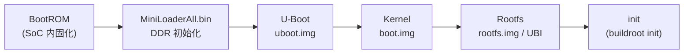

# 启动链与烧写

> 这张图和下面的表，是第 1 周的验收标准，也是 JD 原话对照项（「具备底层 Panic/Oops 及现场排查能力」的前置知识）。第 8 周面试前会回来看。

## 启动链路



| 级 | 存在哪个介质 | 职责 | 我的理解（自己写，不许抄） |
| --- | --- | --- | --- |
| BootROM | SoC 内部 | | |
| MiniLoader | NAND/SD 特定偏移 | | |
| U-Boot | | | |
| Kernel | boot 分区 | | |
| Rootfs | | | |
| init | | | |

**关键问题**（第 1 周要能答）：

- `bootargs` 从哪来？谁传的？改了怎么生效？
- U-Boot 环境变量存在哪？`saveenv` 之后写到了什么位置？
- 怎么进 MaskROM 模式？和 Loader 模式的区别是什么？
- 分区表（parameter.txt）里各分区的偏移和大小怎么读？

## 介质与镜像选择

| 介质 | 镜像 | 读写 | 用在 |
| --- | --- | --- | --- |
| TF 卡 | `rk3506b_update_sd.img` | 可读写 | 第 1–3 周日常开发（写坏了重刷一张卡就行） |
| NAND | `rk3506b_update_ubi_ubifs.img` | 可读写 | 需要持久化数据时 |
| NAND | `rk3506b_update_ubi_squashfs.img` | 只读 | 出厂默认；验证稳定性用 |

> 「push 不进文件」的根因就是 NAND 出厂是 squashfs 只读——不是权限问题，别去 `chmod`。

## 烧写记录

| 日期 | 镜像 | 介质 / 入口 | 工具 | 结果 | 问题与解决 |
| --- | --- | --- | --- | --- | --- |
| | | | | | |

## 进 Loader / MaskROM 的步骤

1. 断电
2. 按住 `____` 键（或短接 `____`）
3. 上电，保持 3 秒
4. 电脑端设备管理器出现 `Rockchip USB Device`（Loader）或 `Maskrom Device`
5. 松开

> 实际按键位置以 [hardware/board.md](../hardware/board.md) 记录为准。

## 串口 log 摘录

只保留关键几行（完整 log 不入库）：

```text
（在此粘贴：DDR 初始化行、U-Boot 版本行、内核版本行、rootfs 挂载行、login 提示）
```

## 救砖流程

| 场景 | 现象 | 处理 |
| --- | --- | --- |
| 烧写中断电 | 只能进 MaskROM | 重新进 MaskROM，用 RKDevTool「低级格式化」后重烧 |
| U-Boot 改坏 | 串口无输出 | 短路 CLK/DATA 或按 MaskROM 键强制进入 |
| 根文件系统只读 | 无法写文件 | 换 `ubi_ubifs` 镜像，或改从 TF 卡启动 |

救砖成功后，**必须**在这里补一行记录：怎么进的 MaskROM、哪一步卡住、最后怎么恢复的。
